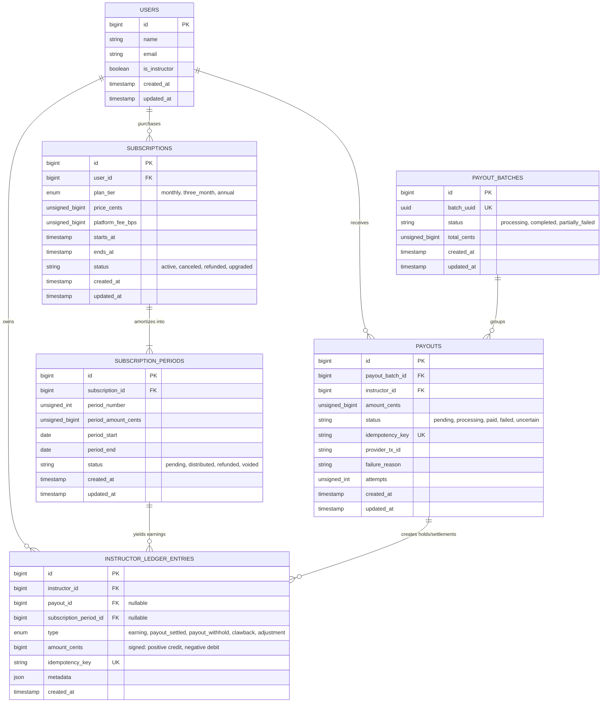
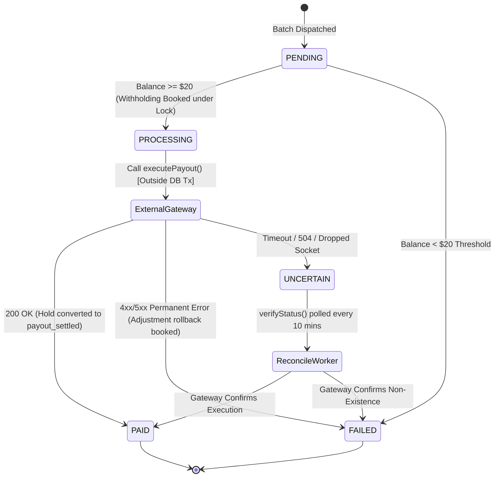

# System Architecture, Concurrency Controls & Database ERD

---

## 1. Database Entity Relationship Diagram (ERD)



---

## 2. Table Indexing & Database Integrity Rules

### `instructor_ledger_entries`
* `PRIMARY KEY (id)`
* `UNIQUE INDEX uq_ledger_idempotency (idempotency_key)` — prevents duplicate allocations/holds.
* `INDEX idx_instructor_type (instructor_id, type)` — accelerates balance `SUM(amount_cents)`.
* `INDEX idx_period_id (subscription_period_id)` — speeds up period-level auditing.

### `payouts`
* `PRIMARY KEY (id)`
* `UNIQUE INDEX uq_payout_idempotency (idempotency_key)` — one payout record per batch per instructor.
* `INDEX idx_instructor_status (instructor_id, status)` — verify existing active/pending payouts.
* `INDEX idx_reconciliation (status, updated_at)` — locate `uncertain` payouts older than 5 minutes.

### `subscription_periods`
* `UNIQUE INDEX uq_sub_period (subscription_id, period_number)` — enforces correct chronological accrual.

---

## 3. Concurrency Protection Layers

```
Layer 1: Distributed Redis Cache Lock (Command Entrypoint)
  │── Command: Cache::lock('payouts_execution_lock', 7200)
  └── Eliminates overlapping execution across multiple web/cron instances.
       │
Layer 2: Deterministic Chunk Streaming
  │── User::where('is_instructor', true)->chunkById(250)
  └── Eliminates memory leaks and cursor drift across 500k records.
       │
Layer 3: Row-Level Pessimistic Locking (Within DB Transaction)
  │── User::where('id', $instructorId)->lockForUpdate()
  └── Serializes balance calculations per instructor; blocks competing transactions.
       │
Layer 4: Two-Phase Balance Withholding (Append-Only Ledger)
  │── Books negative 'payout_withhold' entry before touching network
  └── Instantly zeros out available balance, preventing race conditions.
       │
Layer 5: Decoupled Gateway Network Call (Outside DB Transaction)
  │── MockPaymentProvider::executePayout()
  └── DB transaction committed before HTTP call; prevents connection pool exhaustion.
       │
Layer 6: Unique Database Constraints (InnoDB Engine Layer)
  └── Physical defense against double-inserts if application-level checks are breached.
```

---

## 4. Payout Finite State Machine


